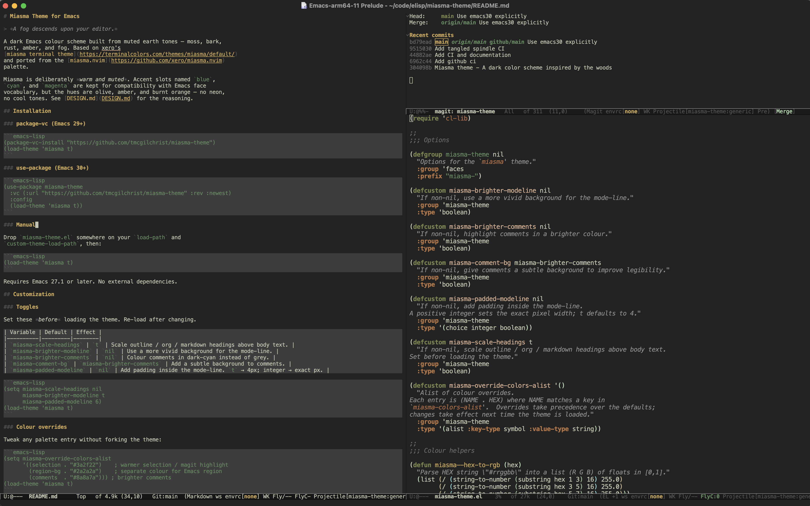

# Miasma Theme for Emacs

> *A fog descends upon your editor.*



A dark Emacs colour scheme built from muted earth tones — moss, bark,
rust, amber, and fog. Based on xero's
[miasma terminal theme](https://terminalcolors.com/themes/miasma/default/)
and ported from the [miasma.nvim](https://github.com/xero/miasma.nvim)
palette.

Miasma is deliberately *warm and muted*. Accent slots named `blue`,
`cyan`, and `magenta` are kept for compatibility with Emacs face
vocabulary, but the hues are olive, amber, and burnt orange — no neon,
no cool tones. See [DESIGN.md](DESIGN.md) for the reasoning.

## Installation

### package-vc (Emacs 29+)

```emacs-lisp
(package-vc-install "https://github.com/tmcgilchrist/miasma-theme")
(load-theme 'miasma t)
```

### use-package (Emacs 30+)

```emacs-lisp
(use-package miasma-theme
  :vc (:url "https://github.com/tmcgilchrist/miasma-theme" :rev :newest)
  :config
  (load-theme 'miasma t))
```

### Manual

Drop `miasma-theme.el` somewhere on your `load-path` and
`custom-theme-load-path`, then:

```emacs-lisp
(load-theme 'miasma t)
```

Requires Emacs 27.1 or later. No external dependencies.

## Customization

### Toggles

Set these *before* loading the theme. Re-load after changing.

| Variable | Default | Effect |
|----------|---------|--------|
| `miasma-scale-headings` | `t` | Scale outline / org / markdown headings above body text. |
| `miasma-brighter-modeline` | `nil` | Use a more vivid background for the mode-line. |
| `miasma-brighter-comments` | `nil` | Colour comments in dark-cyan instead of grey. |
| `miasma-comment-bg` | `miasma-brighter-comments` | Add a subtle background to comments. |
| `miasma-padded-modeline` | `nil` | Add padding inside the mode-line. `t` → 4px; integer → exact px. |

```emacs-lisp
(setq miasma-scale-headings nil
      miasma-brighter-modeline t
      miasma-padded-modeline 6)
(load-theme 'miasma t)
```

### Colour overrides

Tweak any palette entry without forking the theme:

```emacs-lisp
(setq miasma-override-colors-alist
      '((selection . "#78824b")))  ; tint the selection olive instead of gold
(load-theme 'miasma t)
```

The region background is the `selection` colour blended into the
background at `miasma-selection-alpha` (default `0.15`). Raise it for a
stronger highlight, or override `region-bg` to set an exact colour:

```emacs-lisp
(setq miasma-selection-alpha 0.3)                            ; stronger tint
(setq miasma-override-colors-alist '((region-bg . "#333333"))) ; plain grey
```

Inspect `miasma-colors-alist` for every available slot. Overrides take
effect at theme-load time.

### Using the palette in your config

The palette and helpers are ordinary top-level definitions — no macros
needed:

```emacs-lisp
(let ((green (alist-get 'green miasma-colors-alist))
      (fg   (alist-get 'fg    miasma-colors-alist)))
  (setq pdf-view-midnight-colors (cons fg (miasma-darken green 0.8))))
```

Available helpers:

- `miasma-colors-alist` — the palette, `(symbol . "#rrggbb")` pairs.
- `(miasma-darken HEX FRACTION)` — darken toward black by `FRACTION` in `[0,1]`.
- `(miasma-lighten HEX FRACTION)` — lighten toward white.

### Per-mode face overrides

For per-buffer tweaks that shouldn't affect other modes, use
`face-remap-add-relative` in a mode hook:

```emacs-lisp
;; Italic line numbers only in prog-mode
(add-hook 'prog-mode-hook
          (lambda ()
            (face-remap-add-relative 'line-number :slant 'italic)))

;; Larger font in eww
(add-hook 'eww-mode-hook
          (lambda ()
            (face-remap-add-relative 'default :height 1.15)))
```

## Supported packages

Beyond every built-in Emacs face, miasma tunes these packages:

- **Completion:** vertico, corfu, marginalia, ivy
- **Development:** magit, flymake, flycheck, eglot, tree-sitter-hl, compilation
- **UI:** doom-modeline, solaire-mode
- **Writing:** org-mode (levels, agenda, blocks, code, dates, todo),
  markdown-mode, outline
- **Diff:** diff-mode, ediff
- **Misc:** dired, isearch, ansi-color, whitespace-mode, LaTeX, css/scss

Missing a package? Open an issue or a PR.

## Complementary terminal theme

For a matching terminal, use xero's original miasma configs:

- **Source:** [xero/miasma.nvim](https://github.com/xero/miasma.nvim) — the
  neovim port carries the canonical palette definition.
- **Terminal downloads:** [terminalcolors.com/themes/miasma](https://terminalcolors.com/themes/miasma/default/)
  has ready-to-use configs for Terminal.app, iTerm2, Alacritty, Warp,
  and Ghostty.

Pairing Emacs miasma with a terminal miasma gives a consistent look
across `emacsclient -nw` and any tmux / shell session.

## Design

See [DESIGN.md](DESIGN.md) for the semantic role of each colour and the
principles used when adding faces.

## Changelog

See [CHANGELOG.md](CHANGELOG.md).

## Credits

- Palette by [xero](https://github.com/xero) — originally published as
  the miasma terminal theme and [miasma.nvim](https://github.com/xero/miasma.nvim).
- Earlier Emacs port by [daut](https://github.com/daut/miasma-theme.el)
  — prior art consulted during this implementation.
- Structural inspiration from
  [bbatsov/tokyo-night-emacs](https://github.com/bbatsov/tokyo-night-emacs).

## License

GPL v3+
